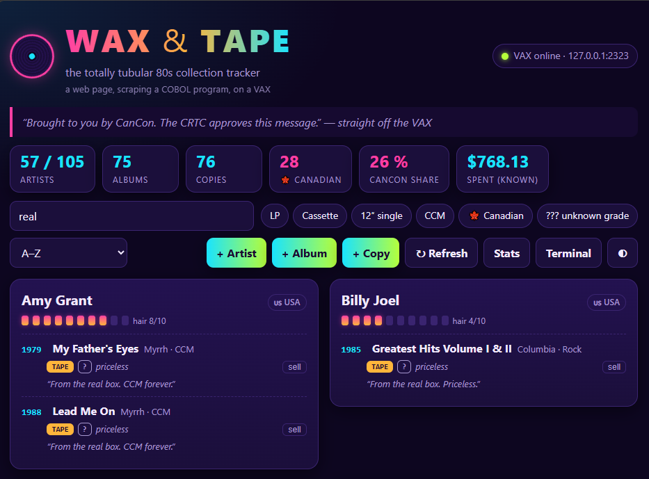

# waxweb -- a web front end that screen-scrapes a VAX

A modern single-page web UI for **WAX & TAPE**, the COBOL + Rdb collection tracker that runs on an
OpenVMS VAX.  The VAX program is untouched menu-driven terminal software; this server logs in over
telnet, starts it, and *types at its menus like a person*, turning the text screens it prints into JSON
for the browser.  (The UI even has a live "VAX terminal" drawer showing the screens being scraped.)



```
 browser  <--HTTP-->  waxweb.py  <--telnet-->  VAX: @RUN_WAXR  ->  COBOL + embedded SQL  ->  Rdb
 (static SPA)        (Python 3.7, stdlib only)      (menu screens, fixed-width text)
```

## Files

| File | Purpose |
|---|---|
| `vaxterm.py` | tiny telnet terminal (IAC negotiation, VT100 stripping, send/read-until-prompt) |
| `power.py` | is the on-demand VAX powered on (systemd), and power it on |
| `waxscrape.py` | parsers for the roll-call / stats screens, and the session driver that plays the menus (pager, Y/N pickers, add/sell flows) |
| `waxweb.py` | HTTP server: JSON API + static files, optional basic auth |
| `static/` | the single-page UI (no build step): search, filters (LP / cassette / 12" / CCM / Canadian), add/sell dialogs, stats and terminal drawers |
| `fakevax.py` | a fake VAX (VMS login + a Python port of the WAXR screens) for development and tests |
| `run_demo.py` | web app + fake VAX in one process (`python3 run_demo.py`, then http://localhost:8088) |
| `tests/` | parser tests against **real captured VAX screens** + end-to-end tests against `fakevax` |
| `deploy/` | env template and the VMS account setup (the systemd unit and nginx location live in `POSIX/web-ttyd`) |

Run the tests with `python3 -m unittest discover -s tests -v` (Python 3.7+; no dependencies).

## How the scraping works

* **Login:** read `Username:` / `Password:`, send them (the password is never logged -- the transcript
  shows `********`), then set a unique DCL prompt (`<<WAX>> `), widen the terminal, `SET DEFAULT` to the app
  directory and `@RUN_WAXR`.  The menu prompt `Your pick, music lover:` is the "ready" marker for everything.
* **Reading:** option 1 (roll call) is walked page by page -- every `-- more --` pager prompt gets an Enter.
  Lines are fixed-width (`DISPLAY` of COBOL fields), so the parser slices by column.  Option 8 gives the stats
  and verdicts; the roll call's last line supplies the quip shown at the top of the page.
* **Writing:** add artist/album/copy and sell are driven through the same prompts a person would answer.
  The "Is it X? (Y/N)" / "This one? (Y/N)" pickers are answered by comparing the on-screen name/title/artist
  with the one wanted (`Y` on an exact match, `N` otherwise), and a sale double-checks the numbered list it is
  shown before choosing a copy -- if it does not match what the UI expected, it answers `0` (keep everything).
* **One session, one lock:** a single logged-in VMS session serves all requests, serialised by a lock; if the
  session breaks it is dropped and re-created on the next request.  The roll call is cached (default 120 s)
  and invalidated by every write.

## When the VAX is on demand

The simh VAX on cpbee is off until someone powers it on, and switches itself off after 30 idle minutes
(`VAX/simh/ondemand/`).  waxweb copes with that:

* **Off, booting, or refused.**  Set `VAX_UNIT=vax.service` and waxweb asks systemd whether the VAX is powered
  (`/api/health` -> `vaxState`: `ready`, `idle`, `off`, `booting`, `up`, `logging-in`, `login-failed`,
  `unreachable`).  A request while it is off fails at once with HTTP 503 and `vaxState` -- no 15-second hang.
  Unset, the VAX is assumed always on and a silent VAX is reported as `unreachable`.
* **Power on from the page.**  When the VAX is off the page shows a banner with a **Power on the VAX** button
  (`POST /api/vax/power-on`, which runs `sudo -n /usr/bin/systemctl start $VAX_UNIT` -- the one thing
  `ondemand/install.sh` lets the web user do; override with `VAX_START_CMD`).  The page then polls
  `/api/health?probe=1` every 4 s (the probe opens and closes a telnet connection, so only the waiting page
  asks) and reloads the collection when telnet answers.  Logging in then takes as long as VMS takes (up to 3 min).
* **A hung-up session.**  Before each request the telnet socket is checked; if the VAX closed it (idle shutdown,
  reboot) waxweb logs in afresh instead of failing.  `VAX_SESSION_IDLE` (default 600 s, 0 = never) logs out of VMS
  when nobody has used the session, so a VMS `SHUTDOWN` never finds waxweb holding Rdb open.  A VAX that is
  stopped without closing the connection (simh killed) is only noticed when a request times out.
* **Refused logins.**  A rejected login (wrong or expired password) pauses logins for 1, then 5, then 15 minutes,
  so repeated page loads cannot trip VMS intrusion detection and lock the account.  `vaxState` is `login-failed`
  and the page says so.

Not known yet: whether browsing through waxweb counts as activity to `vax-ctl`'s idle check (a roll call is light
on CPU and network), so the VAX could switch itself off under an open page.  Watch `vax-ctl status` once.

## Running it for real

1. **The VAX side** -- create the dedicated low-privilege account and grant it the program + database:
   see `deploy/vms_account.txt`.
2. **On cpbee** (where the simh VAX runs; it reaches OpenVMS at `192.168.20.30:23` directly, no tunnel):
   put this repo's `VAX/waxweb` at `~/gh_cp/VAX/waxweb`, create `~/.config/waxweb.env` from
   `deploy/waxweb.env.example` (mode 600) with the VMS account's password, then run `POSIX/web-ttyd/install.sh`.
   It installs the user unit `web-ttyd-waxweb.service` (waxweb on `127.0.0.1:8088`) and the nginx location
   that serves it at **https://192.168.10.1:8444/waxweb/** behind the same password as the terminal apps.
3. To run it elsewhere, set `VAX_HOST`/`VAX_PORT` to where telnet is reachable and start `waxweb.py` yourself;
   the page works at any path (its URLs are relative).

`python3 run_demo.py` runs the same UI against the built-in fake VAX, with no VAX and no password.

## Security notes

* The web app holds a VMS password: use the dedicated unprivileged account, keep the env file `chmod 600`,
  and never commit it.
* The UI can add and *delete* records.  It listens on loopback only; nginx supplies the login (do not also set
  `WAXWEB_AUTH`).  Elsewhere, keep it on a trusted LAN or behind a reverse proxy with authentication.
* `/api/transcript` exposes the scraped screens (not the password) -- same trust boundary as the UI.
* Input going to the VAX is stripped of control characters and truncated to the COBOL field widths.
